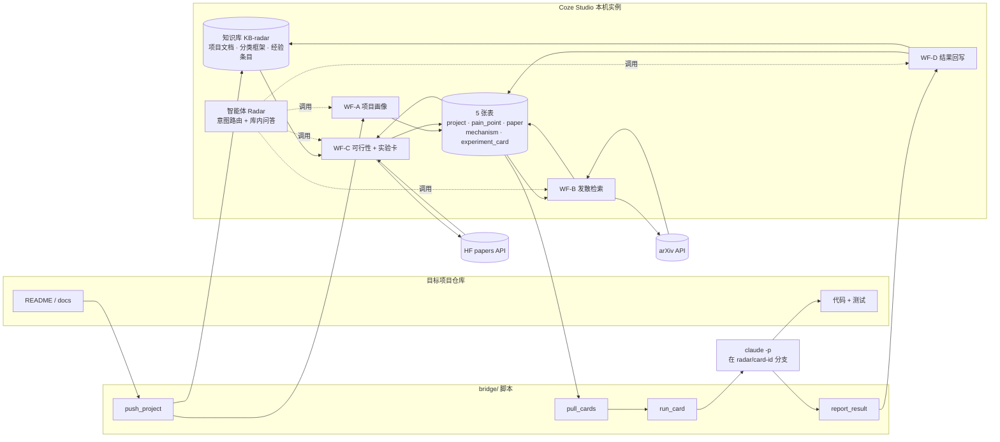

# READAR · 论文→实践雷达

> **Re**search **a**gent for **D**iscovering **A**pplicable **R**esults. 给定一个正在开发的项目，去 arXiv 找论文里**可以单独移植的机制**，判断可行性，生成**最小规模、可测量**的实验卡，交给编码 Agent（Claude Code）在项目分支上试，结果和经验回写，供下一轮判定参考。

运行时是开源的 [Coze Studio](https://github.com/coze-dev/coze-studio)：5 张数据表、1 个知识库、4 条工作流、1 个智能体。编排不在界面上拖，全部由 `bridge/` 下的 Python 脚本通过 Coze Studio 的内部接口完成，画布 JSON 由脚本生成。Claude Code 的执行在目标项目仓库里，Coze 只负责找、判、出卡、记结果。

---

## 目录

1. [为什么做这个](#1-为什么做这个)
2. [一次完整运行长什么样](#2-一次完整运行长什么样)
3. [架构](#3-架构)
4. [数据模型](#4-数据模型)
5. [四条工作流](#5-四条工作流)
6. [实验卡与执行护栏](#6-实验卡与执行护栏)
7. [从零复现](#7-从零复现)
8. [脚本参考](#8-脚本参考)
9. [设计决策与借鉴来源](#9-设计决策与借鉴来源)
10. [Coze Studio 开源版的边界与踩坑](#10-coze-studio-开源版的边界与踩坑)
11. [已知局限](#11-已知局限)
12. [成本](#12-成本)
13. [目录结构](#13-目录结构)

---

## 1. 为什么做这个

现有的论文追踪工具（arxiv-sanity、Scholar Inbox、zotero-arxiv-daily 等）回答的是"这篇论文我感兴趣吗"；科研 Agent（PaSa、PaperQA2、Ai2 Paper Finder）回答的是"给一个问题，把相关论文找全"。两类都停在"读"。

READAR 换一个问题：**这篇论文里有没有一个机制，能用半天以内的改动搬进我手头的项目，并且搬完能测出来？** 它的判定对象不是论文，是**机制**（一个可独立实现的技术做法：一种恢复策略、一种上下文压缩方法、一种评测指标）；它的反馈信号不是点赞，是**编码 Agent 跑完实验后的结果**。

一张实验卡被刻意限制为最小实验：最多改 3 个文件、不超过 6 步、必须包含一条项目里真实存在的可运行命令、预算 45 分钟以内。目的是验证"值不值得深入"，不是把功能做完。

## 2. 一次完整运行长什么样

目标项目：一个零售备货 Agent 系统（FastAPI + LangGraph，有 pytest 和模拟器）。完整报告见 [docs/DEMO-example.md](docs/DEMO-example.md)，选中的卡见 [docs/CARD-example.md](docs/CARD-example.md)。

| 步骤 | 发生了什么 |
|---|---|
| WF-A 项目画像 | 读 README、HANDOVER、架构文档，抽出 9 个模块、6 条原样抄录的评测命令、8 条有文档依据的痛点 |
| 选痛点 | "Agent 每次运行最多 8 轮模型、12 次工具、90 秒窗口；崩溃时可能重发同一逻辑轮次产生额外用量" |
| WF-B 发散检索 | 痛点改写成两组 AND 的 arXiv 检索式；15 篇逐篇判定，留 13 篇，拆出 54 条机制（幂等键、步级检查点、Verify-Before-Retry、沙箱超时……） |
| WF-C 可行性与出卡 | 多准则判定（要不要训练、要不要外部数据、改动范围、项目里能不能评测），27 条过线，每条生成一张最小实验卡 |
| Claude Code 执行 | 选预算最小的卡："子进程沙箱 + 2 秒墙钟超时，只包一个只读工具，默认关闭"。4.3 分钟、34 轮、约 1.25 美元，改 3 个文件，测试通过数 514 → 514 |
| WF-D 回写 | verdict = **neutral**。经验条目入库："回归未启沙箱，单测等效。局限：未跑启沙箱的整套回归。适用条件：仅单一只读工具……" |

另一张卡（"按失败类型选恢复动作"收成只处理 429 限流的最小版，来自 arXiv 2602.15197）结果是 win：测试 148 → 149，改 2 个文件。但 Claude Code 自己指出：后端在把工具结果交给 Agent 之前已把 HTTP 错误转成普通失败，真实 429 根本走不到这个分支。**这类"接得进去但不会生效"的发现，是这套流程最有价值的输出**，它也被压成经验条目，下一轮判定时会被检索到。

## 3. 架构



**和 Coze 核心模块的对应：**

| Coze 模块 | 在 READAR 里 |
|---|---|
| 智能体编排 | 一个智能体挂 4 条工作流 + 知识库 + 5 张表，靠人设里的路由规则决定调哪条；问答走 NL2SQL 查表 + 知识库检索 |
| 插件 | 开源版自定义插件注册流程较重，外部数据全部用 **HTTP 请求节点**直连 arXiv API、OpenAlex、Hugging Face |
| 知识库 | 三类文档：项目文档（给出卡节点检索真实命令）、分类框架、经验条目（给判定节点做参考） |
| 工作流 | LLM 结构化输出、代码节点（Python）、批处理、条件、自定义 SQL、知识库检索；定时触发开源版没有，由外部 cron 调 OpenAPI |
| 数据库 | 5 张表承载全部状态，机制和卡的 status 字段是整个流程的状态机 |

## 4. 数据模型

| 表 | 关键字段 | 说明 |
|---|---|---|
| `project` | name, repo_path, stack, summary（含模块清单和评测命令）, kb_doc_ids | 一行一个项目 |
| `pain_point` | project_id, module, description, metric, priority, status | WF-A 产出；**人工过一遍**再用 |
| `paper` | arxiv_id, title, authors, published, abstract, url, code_url, source, first_seen | 按 arxiv_id 去重 |
| `mechanism` | arxiv_id, name, description, target_module, how_to_apply, pain_point_id, relevance, relevance_reason, tags（闭环环节 / 单多 Agent / 中心化）, feasibility_json, feasibility_score, status | 一篇论文可拆多条；status：candidate → carded / rejected → tried |
| `experiment_card` | mechanism_id, title, hypothesis, change_scope, steps, eval_method, budget_min, status, result_json, verdict, note | status：new / blocked → done / failed；verdict：win / neutral / lose / blocked |

## 5. 四条工作流

### WF-A 项目画像（`wfa_build.py`）

Entry(project_name, repo_path, stack, docs_text) → LLM 结构化输出 {summary, eval_commands[], modules[], pain_points[]} → 代码节点拆平 → SQL 写 project → 查回 id → 批处理写 pain_point。

要点：评测命令要求**原样抄录文档里出现过的命令**，这是后面实验卡"必须含可运行命令"的来源。

### WF-B 发散检索（`wfb_build.py`）

Entry(pain_text, module_text, project_summary, max_results, threshold, pain_point_id)
→ LLM 生成 3–5 条 query 并合成一条 arXiv 检索式（两组 AND，每组 3–6 个 OR 项，每项 1–2 词）
→ 代码节点 URL 编码 → HTTP 请求 arXiv API → 代码节点解析 Atom XML
→ **批处理**（并发 5）：每篇一个 LLM 节点做"机制判定"——先输出 decision 再输出理由，再列 mechanisms[]，每条带 target_module、how_to_apply、relevance、三个分类标签
→ 代码节点按阈值过滤、排序 → SQL 查已有论文去重 → 两个批处理分别写 paper 和 mechanism。

判定 prompt 里写明什么不算机制："提出 benchmark 但没有方法；需要重新训练模型；整篇只有分析讨论"。实测 25 篇里否决 12 篇，理由全部落在这三类。

### WF-C 可行性与实验卡（`wfc_build.py`）

Entry(project_summary, module_text, min_relevance, limit, threshold, eval_commands, pain_point_id)
→ SQL 读 candidate 机制和论文摘要 → 代码节点按论文分组（机制用局部序号 idx，避免 LLM 回填 19 位 id 丢精度）
→ **批处理（按论文）**：HTTP 查 Hugging Face 论文页拿代码链接 → LLM 多准则可行性（needs_training / needs_external_data / framework_dependency / has_reference_impl / change_scope S|M|L / eval_feasible_in_project / single_mechanism_transplantable，每项附原文证据句）→ 代码节点加权打分，硬否决"需要训练"和"大范围改动"
→ 拆平 → 批处理写回 feasibility 和 status
→ **批处理（按过线机制）**：代码节点拼检索词 → 知识库检索项目文档 → LLM 生成实验卡（范围、步骤、评测命令受硬约束）→ SQL 写 experiment_card。

### WF-D 结果回写（`wfd_build.py`）

Entry(card_id, verdict, metric, baseline, after, notes, changed_files, elapsed_min, project_name) → SQL 读卡 → 更新卡状态与结果 → 机制置 tried → LLM 压成一条 160 字以内的经验（含"局限"一句）→ 返回；bridge 把经验写进知识库（开源版知识库写入节点只收文件，不收文本）。

## 6. 实验卡与执行护栏

卡的硬约束写在出卡 prompt 里：

1. 最多改 3 个文件，不改公开接口、不改数据库迁移、不加依赖；只做机制的最小版本。
2. 假设格式固定："把 <机制最小版> 用在 <模块> 的 <位置>，预期 <指标> 相对基线 <方向/幅度>"，指标必须是某条可运行命令的输出。
3. 步骤 ≤ 6，第一步"运行 <命令> 记录基线"，最后一步"再次运行同一命令，写 radar_result.json"。
4. 评测命令只能从 WF-A 抽出的列表里原样选；找不到就 `blocked=true` 并写缺什么。
5. 预算 ≤ 45 分钟。

`run_card.py` 的护栏：拒绝在有未提交改动的仓库上运行；从当前 HEAD 开分支 `radar/card-<id>`；`claude -p` 只开白名单工具（Read/Edit/Write/Glob/Grep + git/python/pytest/uv 等 Bash 前缀）；硬超时；结束后只提交已跟踪文件的修改和 `radar_result.json`，切回原分支；不推送、不合并。

## 7. 从零复现

### 7.1 环境

- Docker Desktop；Python 3.10+ 和 `pip install -r requirements.txt`（只依赖 `requests`）
- [Claude Code](https://claude.com/claude-code) CLI（跑实验卡用）
- 一个 OpenAI 协议的模型 Key（本项目用 gpt-5；其他 OpenAI 兼容模型也行，但 Key 和模型名要一起改）

### 7.2 部署 Coze Studio

```bash
git clone --depth 1 https://github.com/coze-dev/coze-studio   # 本项目基于 commit fefb05ff
cd coze-studio
cp docker/.env.example docker/.env
cp <本仓库>/deploy/docker-compose.minio-fix.yml docker/
```

`docker/.env` 里改模型配置（OpenAI 协议、模型名、三处 Key：`MODEL_API_KEY_0`、`OPENAI_EMBEDDING_API_KEY`、`BUILTIN_CM_OPENAI_API_KEY`），然后：

```bash
# Git Bash 下要加 MSYS_NO_PATHCONV=1，否则容器内路径会被改写
MSYS_NO_PATHCONV=1 docker compose -f docker/docker-compose.yml -f docker/docker-compose.minio-fix.yml --env-file docker/.env up -d
```

`minio/minio` 镜像已从 Docker Hub 下架，`deploy/docker-compose.minio-fix.yml` 换成同一构建的 `bitnamilegacy/minio:2025.6.13`。界面在 http://localhost:8888 。

### 7.3 建账号、建存储、建工作流、建智能体

```bash
cd <本仓库>
export PYTHONUTF8=1
python bridge/coze_client.py        # 注册本地测试账号，写 local-account.txt，拿 space_id
python bridge/m1_storage.py         # 5 张表 + 知识库，id 写入 radar_ids.json
# 建智能体并绑表（m5_agent.py 需要 bot_id；首次先建）：
python - <<'EOF'
import sys,json; sys.path.insert(0,'bridge')
from coze_client import Coze, save_account
ids=json.load(open('radar_ids.json',encoding='utf-8')); c=Coze(); c.login()
b=c.post('/api/draftbot/create',{'space_id':c.space_id(),'name':'Radar','description':'READAR','icon_uri':'default_icon/default_agent_icon.png','create_from':'space'})
c.acct['bot_id']=str(b['data']['bot_id']); save_account(c.acct)
lst=c.post('/api/memory/database/list',{'space_id':c.space_id(),'table_type':1,'limit':50,'offset':0})['database_info_list']
ids['tables_online']=dict(ids['tables']); ids['tables']={d['table_name']:str(d['draft_id']) for d in lst}
json.dump(ids,open('radar_ids.json','w',encoding='utf-8'),ensure_ascii=False,indent=1)
for t in ids['tables'].values(): c.post('/api/memory/database/bind_to_bot',{'database_id':t,'bot_id':c.acct['bot_id']})
EOF
python bridge/m2_smoke.py           # 开始→LLM→结束，验证 Key 和画布保存
python bridge/wfb_build.py --no-run
python bridge/wfc_build.py --no-run
python bridge/wfd_build.py
python bridge/wfa_build.py <项目名> <仓库路径> "<技术栈>" projects/<项目名>.docs.txt --no-run
python bridge/m5_agent.py           # 人设、模型、4 条工作流、知识库
```

### 7.4 接入一个项目并跑一轮

```bash
python bridge/push_project.py MyProj /path/to/repo --files README.md docs/architecture.md   # 文档进知识库
python bridge/wfa_build.py MyProj /path/to/repo "Python, FastAPI, LangGraph" projects/MyProj.docs.txt
# 从输出里挑一个 pain_point id（也可以在界面的 pain_point 表里改、删、补）
python bridge/demo.py --project MyProj --repo /path/to/repo --pain-point-id <id> --max-results 15 --budget-min 20
```

`demo.py` 依次跑 WF-B → WF-C → 选预算最小的卡交给 Claude Code → WF-D，生成 `demo/DEMO-<时间>.md`。`--from-cards` 跳过前两步，`--skip-cc` 不执行卡。

## 8. 脚本参考

| 脚本 | 作用 |
|---|---|
| `coze_client.py` | 登录（手动处理 localhost cookie）、通用 POST/GET、会话过期自动重登、space_id |
| `canvas.py` | 画布节点构造器：Entry / Exit / LLM / Code / HTTP / Batch / Selector / CustomSQL / KnowledgeRetriever，边和端口约定 |
| `workflow_api.py` | create / save / test_run（轮询 get_process）/ publish |
| `m1_storage.py` | 建 5 张表和知识库 |
| `m2_smoke.py` | 最小工作流冒烟 |
| `m5_agent.py` | 配置智能体 |
| `push_project.py` | 项目文档切片进知识库，拼 docs_text |
| `wfa_build.py` / `wfb_build.py` / `wfc_build.py` / `wfd_build.py` | 四条工作流的画布生成、保存、试运行 |
| `sql_admin.py` | 用单节点工作流跑一条维护 SQL（Coze 没有裸 SQL 接口） |
| `pull_cards.py` | 把卡导出为 `cards/CARD-<id>.md` |
| `run_card.py` | 在目标仓库开分支，用 `claude -p` 跑卡，收集 `radar_result.json`，提交，切回 |
| `report_result.py` | 调 WF-D 回写，把经验写进知识库 |
| `demo.py` | 一键串联并生成报告 |

## 9. 设计决策与借鉴来源

| 决策 | 借自 | 说明 |
|---|---|---|
| 判定对象是"机制"而不是"论文" | 自己的 | 一篇论文拆多条，每条落到项目的具体模块和改法 |
| 一句话痛点改写成多条 query 再合成检索式 | Ai2 Paper Finder、SPAR | 实测长短语一篇都搜不到，所以限定每项 1–2 词、两组 AND |
| 逐篇判定"先 decision 再理由" | [PaSa](https://github.com/bytedance/pasa)（ACL 2025）的 Selector | 不训模型的 PaSa-GPT-4o 版 precision 与训练版相近，所以直接用提示版 |
| 相关性 0–10 分 + 一句理由 + 阈值 | [ArxivDigest](https://github.com/AutoLLM/ArxivDigest) | 理由就是"为什么推给你" |
| 多准则可行性列，每项附原文证据 | [Elicit](https://elicit.com) 的筛选列、AI-Researcher 的资源过滤 | 硬否决"需要训练""大范围改动""需要模型内部访问" |
| 代码链接从 Hugging Face 论文页取 | cv-arxiv-daily 的代码回查 | Papers with Code 2025-07 已关闭 |
| 实验结果压成经验、下一轮检索到 | arXiv_recbot / PaperFlow 的反馈闭环 | 反馈信号从点赞换成实验 verdict |
| 一层引用扩展（OpenAlex 单条查询免费） | PaSa、PaperQA2 | PaSa 消融：去掉扩展 recall 0.61 → 0.29。**v1 未实现**，留在路线图 |
| 不做 search/expand/stop 的 Agent 循环 | — | Agent Laboratory 自报该环节成功率 60–80%，v1 用固定流程替代 |

## 10. Coze Studio 开源版的边界与踩坑

都在搭建中实际碰到并验证：

- **数据库有两套 id。** 工作流节点里的 `databaseInfoID` 用上线 id（`database/add` 返回的 `id`）；`bind_to_bot`、`list_records` 用草稿 id（`database/list` 的 `draft_id`）。带数据库节点的 `test_run` 必须传 `bot_id`。
- **代码节点把输入当命令行参数传给沙箱**（Deno + Pyodide），输入超过约 100KB 报 "argument list too long"。arXiv HTML 约 800KB 进不了代码节点，大文本要走知识库。沙箱默认无网络，外部请求只能用 HTTP 节点。
- **推理模型的 maxTokens**：gpt-5 的推理 token 算在输出配额里，LLM 节点 maxTokens 给 1024 会截断导致 JSON 解析失败，8192 起步；每篇论文判定约 2k 输出 token。
- **LLM 回填 19 位整数 id 会丢精度**，多条评估映射到同一条机制。给局部序号，代码节点映射回真实 id。
- **会话约 20 分钟过期**，长流程中途会 "session not exist"。客户端遇到就重登。
- **没有定时触发器**（只有一个界面标签位），日报类需求靠外部 cron 调 OpenAPI。
- **知识库写入节点只收文件**，不收文本；写经验条目由 bridge 调文档创建接口。
- **自定义 SQL 节点**用 `'{{param}}'` 模板；主键列叫 `id`，`list_records` 返回时叫 `bstudio_id`。
- requests 的 cookiejar 会丢 `localhost` 域的 cookie，登录后要手动把 `session_key` 放进 Cookie 头。
- 代码节点的 Python 源码字符串里不能有真实换行，构造时用 `chr(10)`。

## 11. 已知局限

- **可行性只看摘要**，不读全文；全文要走知识库切片 + 检索（路线图）。
- **可行性打分偏乐观**（只看摘要时 LLM 对"项目里能不能评测"几乎一律说能），真正起过滤作用的是出卡阶段"找不到可运行命令就 blocked"（一次 11 张卡拦下 6 张）。
- **实验卡的指标多是"测试通过数不下降 / +1"**，验证的是能否无损接入，不是有效性。有效性需要靶向评测（故障注入、模拟器），这是下一阶段。
- **WF-A 从文档抽出的痛点偏运维**（worker 不自动拉起、启动器没有 stop），研究味的痛点要人工补或改写。痛点清单是整条链路的锚，必须人工过一遍。
- 宽泛的痛点一轮会出 50 多条机制，WF-C 要用 `limit` 控制规模。
- 没有稳定性处理：无断点续跑、无失败重试（`demo.py --from-cards` 是手动续跑）。
- 引用扩展、HF 热度排序、代码延迟回查、周报趋势未实现。

## 12. 成本

实测（gpt-5，2026-10）：WF-B 25 篇一轮约 7.7 万 token（输出 5.5 万，约 0.5 美元，4.5 分钟）；WF-C 40 条机制约 14 分钟，12 条约 4 分钟；WF-A 一次约 3.7 万 token；Claude Code 一张卡 3–5 分钟、约 1.2 美元。一次完整演示（15 篇、12 条机制、1 张卡）约 2 美元 + 1.2 美元，15 分钟左右。

## 13. 目录结构

```
READAR/
├── README.md               本文
├── PLAN.md                 方案与实施记录（含与原设计的差异）
├── requirements.txt
├── local-account.example.txt
├── deploy/
│   └── docker-compose.minio-fix.yml   MinIO 镜像下架的覆盖文件
├── docs/
│   ├── DEMO-example.md     一次完整运行的报告
│   └── CARD-example.md     一张实验卡
└── bridge/                 全部编排脚本（见第 8 节）

运行时生成、不入库：local-account.txt、radar_ids.json、canvases/、cards/、runs/、demo/、projects/
```

---

这个项目是字节跳动远程实习第一阶段任务（熟悉 Coze 核心模块：Bot 编排、插件、知识库、工作流）的产出，用开源 Coze Studio 替代了不再对新用户开放的低代码平台。
